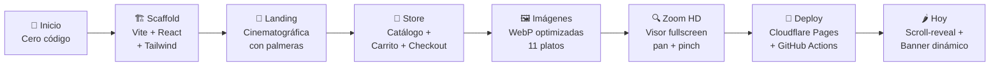
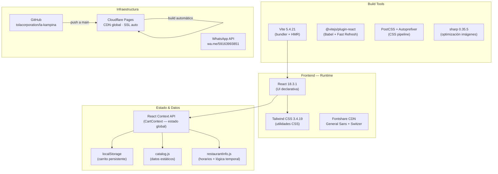
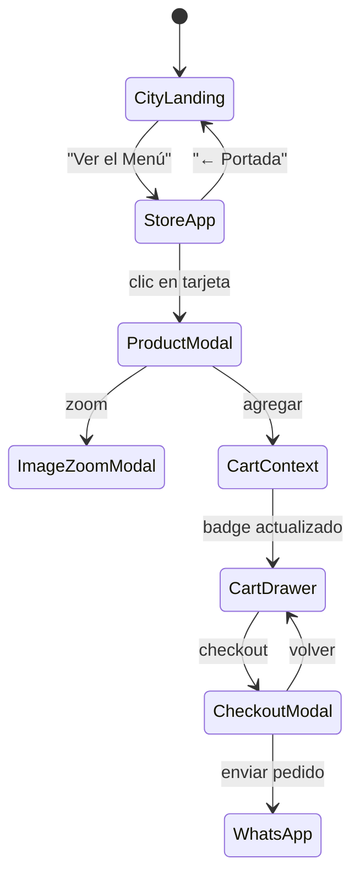
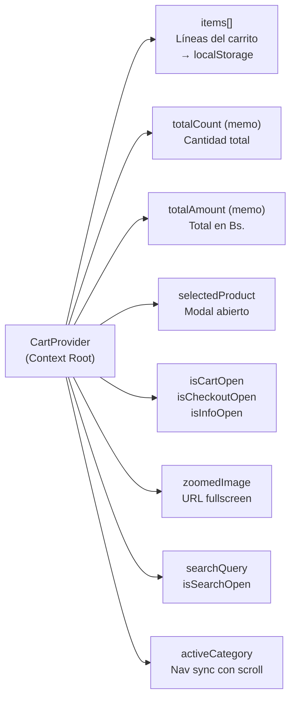
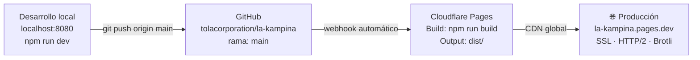
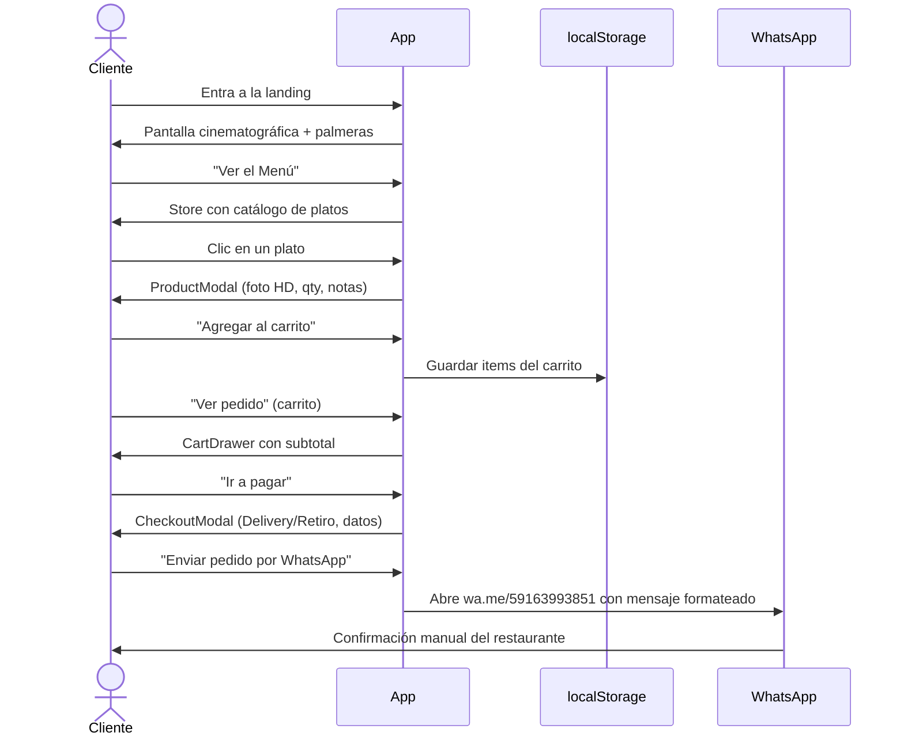
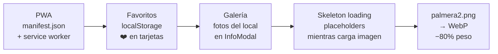

# 🏗️ La Kampiña — Reporte de Infraestructura y Tecnología
> **Versión:** Octubre 2026 · Desde el origen hasta el estado actual · Orientado a escalabilidad futura

---

## 1. Origen del Proyecto

El proyecto nació como una **carta digital de restaurante** para La Kampiña, local de cocina tradicional cochabambina en Bolivia. El objetivo inicial era simple: reemplazar el menú en papel con algo que el cliente pudiera ver desde su celular y hacer un pedido directo por WhatsApp.

**Punto de partida:**
- Sin repositorio, sin código, sin dominio.
- Solo una idea, el logo del restaurante y fotos de los platos.

**Hoy en producción:**
- App web completa en `https://la-kampina.pages.dev`
- 6 commits en `main` · GitHub: `tolacorporation/la-kampina`
- Catálogo interactivo con zoom HD, carrito, checkout → WhatsApp
- Cero dependencia de backend o base de datos

---

## 2. Línea de Tiempo de Desarrollo



### Hitos por commit

| Commit | Descripción | Impacto |
|--------|-------------|---------|
| `8b2c268` | Scaffold inicial, Vite + React + Tailwind, estructura base | Fundación |
| `d70cb55` | Headers Cloudflare, `.nvmrc`, configuración de caché | Infraestructura |
| `2c51c91` | SEO completo: `og:image`, `robots.txt`, `sitemap.xml`, favicon | Visibilidad |
| `f827ace` | Opciones individuales Dúo/Trío, tipografía Fontshare, checkout UX | UX core |
| `1556b3a` | Fotografías WebP, limpieza de textos, visor zoom interactivo | Contenido visual |
| `f5d1464` | Optimización móvil, imágenes ultraligeras, fallbacks elegantes, OpenGraph móvil | Producción |
| *(local)* | Scroll-reveal, banner Ají de Fideo jueves, `kampinafoto2` 1.8MB → 89KB | Mejoras actuales |

---

## 3. Stack Tecnológico Completo



---

## 4. Arquitectura de la Aplicación

### Patrón general: SPA estática con estado en memoria



### Árbol de componentes

```
App.jsx
├── CityLanding.jsx          ← Vista de entrada (landing)
└── CartProvider (contexto)
    └── StoreApp.jsx         ← Shell de la tienda
        ├── StoreHeader.jsx  ← Sticky: logo, búsqueda, nav, carrito
        │   └── [Banner Jueves] ← Condicional: solo aparece los jueves
        ├── StoreCatalog.jsx ← Grid de categorías con scroll-reveal
        │   └── ProductCard.jsx × N   ← Tarjeta animada con Intersection Observer
        ├── ProductModal.jsx ← Detalle: foto, desc, qty, notas
        ├── ImageZoomModal.jsx ← Visor HD: zoom 350%, drag, pinch
        ├── CartDrawer.jsx   ← Drawer lateral del carrito
        ├── CheckoutModal.jsx ← Formulario → WhatsApp
        ├── InfoModal.jsx    ← Horarios, dirección, mapa embebido
        └── WhatsAppFloating.jsx ← Botón flotante global
```

---

## 5. Sistema de Estado (CartContext)

El contexto único es el **corazón de toda la app**. Centraliza el 100% del estado dinámico:



**Funciones expuestas:** `addToCart`, `updateQuantity`, `removeFromCart`, `clearCart`, `formatPrice`, `parsePrice`

> [!NOTE]
> El `lineId` del carrito es compuesto: `productId__optionId__notas`. Esto permite tener el mismo plato con notas distintas como ítems separados sin colisiones.

---

## 6. Catálogo de Datos

### Estructura de un producto en `catalog.js`

```js
{
  id: "prod-charque-duo",          // Identificador único
  name: "Charque Dúo",            // Nombre completo
  shortName: "Charque Dúo",       // Para navegación compacta
  description: "...",             // Descripción gastronómica
  image: "/images/menu/charque/charqueduo.webp",  // WebP con fallback JPEG
  price: 135,                     // Número puro en Bs.
  badge: "2 Personas",            // Badge visual opcional
  isThursdayOnly: false,          // Flag especial (Ají de Fideo = true)
}
```

### Catálogo actual

| Categoría | Ítems | Imagen | Flag especial |
|-----------|-------|--------|--------------|
| Charque | Dúo 135 · Trío 155 | ✅ WebP | — |
| Matahambre | Dúo 135 · Trío 155 | ✅ WebP | — |
| Charkambre | Dúo 135 · Trío 155 | ✅ WebP | — |
| Pique Macho | Dúo 135 · Trío 155 | ✅ WebP | — |
| Planchita de Bronce | Dúo 135 · Trío 155 | ✅ WebP | — |
| Ají de Fideo | Solo 45 Bs. | ✅ WebP | `isThursdayOnly: true` |
| Bebidas | 9 ítems, 10–60 Bs. | ❌ SVG icono | — |

---

## 7. Infraestructura de Deploy



### Cloudflare Pages — Configuración

| Parámetro | Valor |
|-----------|-------|
| Build command | `npm run build` |
| Output directory | `dist/` |
| Branch trigger | `main` |
| SSL | Automático (Let's Encrypt via CF) |
| CDN | Red global Cloudflare (200+ PoP) |
| Compresión | Brotli + Gzip automático |

### Cabeceras HTTP (`public/_headers`)

```
/*
  X-Frame-Options: SAMEORIGIN
  X-Content-Type-Options: nosniff
  Referrer-Policy: strict-origin-when-cross-origin

/assets/*
  Cache-Control: public, max-age=31536000, immutable   ← JS/CSS: 1 año (hash en nombre)

/*.webp
  Cache-Control: public, max-age=2592000, stale-while-revalidate=86400  ← 30 días

/*.jpg  /*.png
  Cache-Control: public, max-age=2592000, stale-while-revalidate=86400
```

---

## 8. Assets y Rendimiento

### Bundle de producción (post-build)

| Archivo | Tamaño raw | Gzip |
|--------|-----------|------|
| `index.js` | 229 KB | **67 KB** |
| `index.css` | 60 KB | **10 KB** |
| **Total JS+CSS** | 289 KB | **~77 KB** |

> [!TIP]
> 77 KB comprimido es extraordinariamente ligero para una app React con esta funcionalidad. La ausencia de librerías de UI externas (Material, Chakra, etc.) es clave.

### Imágenes de menú

| Métrica | Valor |
|--------|-------|
| Platos con imagen WebP | 11 archivos |
| Peso total WebP | ~2.98 MB |
| Peso total JPEG (fallback) | ~3.27 MB |
| Estrategia de carga | `loading="lazy"` + `decoding="async"` + fallback `onError` |

### Assets raíz de producción actuales

| Archivo | KB | Notas |
|--------|-----|-------|
| `kampinafoto2.webp` | **89** | ✅ Optimizado hoy (era 1.8 MB) |
| `fondopiedra.jpg` | 586 | Fondo del store — mejorable |
| `og-image.jpg` | 228 | Open Graph para redes/WhatsApp |
| `logokampina3.webp` | 97 | Logo |
| `palmera-corner-*.webp` | ~93 c/u | 4 palmeras esquineras |
| `palmera2.png` | 225 | ⚠️ PNG sin convertir — pendiente |

---

## 9. SEO y Descubrimiento

| Elemento | Estado |
|---------|--------|
| `<title>` | ✅ "La Kampiña — Cochabamba, Bolivia" |
| `<meta description>` | ✅ Descripción rica |
| Open Graph (`og:image`) | ✅ `og-image.jpg` 1200×630 |
| Twitter Card | ✅ `summary_large_image` |
| `robots.txt` | ✅ Allow all + Sitemap URL |
| `sitemap.xml` | ✅ 2 URLs (landing + store) |
| `apple-touch-icon.png` | ✅ 180×180 |
| `favicon.png` | ✅ |
| Canonical URL | ✅ `la-kampina.pages.dev` |

---

## 10. Lógica Temporal (restaurantInfo.js)

El archivo `restaurantInfo.js` contiene lógica de negocio dependiente del tiempo, todo calculado **en el cliente** con la zona horaria `America/La_Paz` (UTC−4):

| Función | Qué hace |
|--------|----------|
| `getRestaurantOpenStatus()` | Devuelve `{ isOpen, statusText, detailText }` — Mié a Dom 10:30–18:30 |
| `isThursday()` | `true` si hoy es jueves en Bolivia — activa el banner del Ají de Fideo |
| `isAppleDevice()` | Detecta iOS/macOS para abrir Apple Maps vs Google Maps |
| `getDeviceMapInfo()` | Devuelve la URL y nombre de la app de mapas correcta según el dispositivo |
| `openDeviceMap()` | Abre el mapa nativo del dispositivo directamente |

---

## 11. Flujo de Pedido (End-to-End)



---

## 12. Estado Actual — Resumen de Fortalezas

| Área | Estado | Detalle |
|------|--------|---------|
| Performance | 🟢 Excelente | Bundle 77 KB gzip, imágenes lazy, CDN global |
| UX Móvil | 🟢 Muy bueno | Responsive, gestos touch en zoom, sticky header adaptable |
| SEO | 🟢 Completo | OG, sitemap, robots, meta tags |
| Seguridad | 🟢 Básico OK | Headers HTTP, HTTPS, SAMEORIGIN |
| Animaciones | 🟢 Recién añadidas | Scroll-reveal en tarjetas, Ken Burns en landing |
| Catálogo | 🟢 Completo | 6 categorías, 17 productos, precios actualizados |
| Imágenes | 🟢 Optimizadas | WebP + JPEG fallback, sin íconos rotos |
| Deploy | 🟢 Automatizado | Push → build → deploy en ~30s |
| Backend | 🔴 No existe | Diseño intencional: cero servidor, cero BD |
| PWA | 🔴 No existe | Sin manifest.json ni service worker |
| Analytics | 🟡 Parcial | Cloudflare Web Analytics disponible, no activado |
| Pagos | 🔴 No existe | Solo WhatsApp → pago manual |

---

## 13. Roadmap de Escalabilidad

### Fase 1 — Pulido sin backend (bajo esfuerzo, alto impacto)



| Mejora | Archivo(s) | Horas est. |
|-------|-----------|-----------|
| PWA installable | `public/manifest.json` + `vite.config.js` | 2–3h |
| Sistema de favoritos | `CartContext.jsx` + `ProductCard.jsx` | 3–4h |
| Galería del restaurante | `InfoModal.jsx` + fotos nuevas | 2h |
| Skeleton loading | `ProductCard.jsx` | 1–2h |
| Convertir `palmera2.png` a WebP | Script sharp | 0.5h |
| Cloudflare Web Analytics | `index.html` 1 línea | 15min |

### Fase 2 — Funcionalidad expandida (sin backend)

| Mejora | Descripción |
|-------|-------------|
| **Filtros de menú** | Botones "Para 2", "Para 3", "Solo hoy" que filtran el catálogo |
| **Especiales del día** | Sección dinámica según el día de la semana |
| **Contador de apertura** | Si está cerrado: "Abre en X h Y min" en tiempo real |
| **Haptic feedback** | `navigator.vibrate(10)` al agregar al carrito en móvil |
| **Animación carrito** | Ícono del carrito rebota al agregar ítem |
| **Carrusel de destacados** | Platos estrella en rotación en el header |

### Fase 3 — Con backend ligero (escalabilidad real)

> [!IMPORTANT]
> Esta fase requiere agregar un servidor o BaaS. Recomendación: **Supabase** (free tier generoso, SDK JS, PostgreSQL).

| Funcionalidad | Tecnología sugerida | Complejidad |
|--------------|--------------------|-----------| 
| Historial de pedidos | Supabase DB | Media |
| Panel de admin (actualizar precios/menú) | Supabase + Auth | Media-Alta |
| Notificaciones de pedido al restaurante | Supabase Realtime + Edge Functions | Alta |
| QR de pago integrado | Simple (Bolivia) API | Alta |
| Reseñas y ratings | Supabase DB | Media |
| Reservas de mesa | Supabase + calendario | Alta |

### Fase 4 — App nativa (largo plazo)

| Opción | Stack | Ventaja |
|-------|-------|---------|
| PWA avanzada | Vite + Workbox | Sin app store, ya tenemos el código |
| React Native | Expo + Supabase | App Store / Play Store, push notifications |
| Capacitor | Ionic + React | Wrapper nativo sobre el código web actual |

> [!TIP]
> La arquitectura actual (React SPA sin backend) es **perfectamente compatible** con Capacitor. Se podría empaquetar como app nativa con cambios mínimos en el código existente.

---

## 14. Deuda Técnica Identificada

| Ítem | Prioridad | Impacto si se ignora |
|------|-----------|----------------------|
| `palmera2.png` (225 KB sin comprimir) | Media | Carga innecesaria en la landing |
| `fondopiedra.jpg` (586 KB JPEG) | Media | Reemplazable con WebP de ~150 KB |
| Sin PWA / manifest | Alta | No instalable en móvil, sin caché offline |
| Sin analytics | Media | Imposible saber cuántos visitan o qué buscan |
| Sin manejo de errores globales | Baja | Pantalla en blanco en errores inesperados |
| Bebidas sin imagen | Baja | UX incompleta (actualmente SVG icono) |

---

## 15. Configuración del Entorno de Desarrollo

```bash
# Clonar y arrancar
git clone https://github.com/tolacorporation/la-kampina.git
cd la-kampina
npm install
npm run dev -- --port 8080
# → http://localhost:8080

# Build de producción
npm run build        # genera dist/
npm run preview -- --port 8080  # sirve el build local

# Optimizar imagen con sharp
node -e "
  require('sharp')('public/tu-imagen.jpg')
    .resize(1920, null, { withoutEnlargement: true })
    .webp({ quality: 75 })
    .toFile('public/tu-imagen.webp')
    .then(i => console.log(i))
"

# Deploy (solo cuando se autorice)
git add -A
git commit -m 'feat: descripción del cambio'
git push origin main
# Cloudflare Pages hace el deploy automáticamente en ~30s
```

---

*Generado por Antigravity · La Kampiña Web · Octubre 2026*
