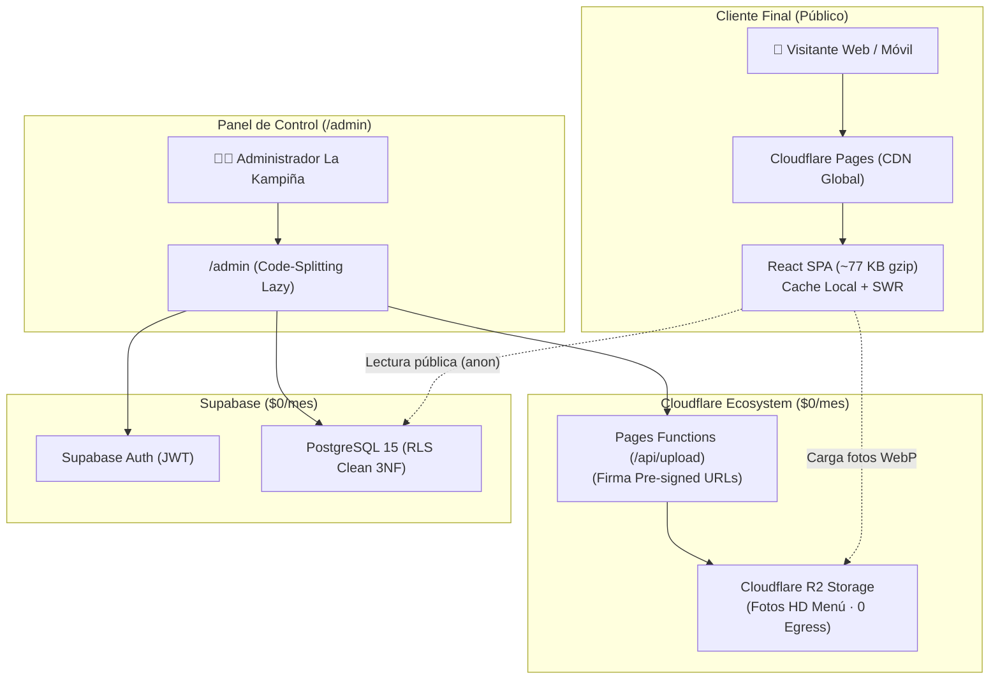
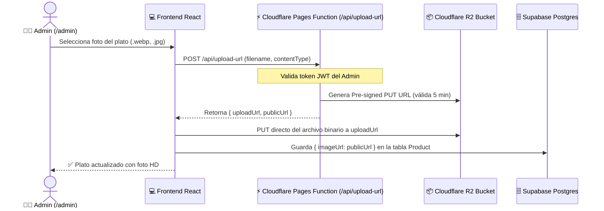
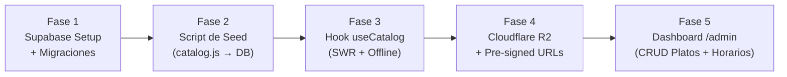

# 🚀 Blueprint de Escalabilidad y Dashboard: La Kampiña (Fase 3 - Dinámica & Resiliente)

> **Contexto:** Este documento define la arquitectura y especificación técnica para evolucionar la aplicación "La Kampiña" de una SPA estática a una plataforma dinámica con panel de administración (`/admin`), preservando el rendimiento extremo actual (bundle público de ~77 KB gzip, carga instantánea) y manteniendo un costo operativo de **$0.00 / mes** aprovechando los planes gratuitos de Cloudflare y Supabase.

---

## 1. Stack Tecnológico & Modelo de Costos ($0.00/mes)



| Componente | Proveedor / Tecnología | Capacidad Nivel Gratuito | Costo |
| :--- | :--- | :--- | :--- |
| **Hosting Frontend** | Cloudflare Pages | Peticiones ilimitadas, ancho de banda ilimitado, SSL automático | **$0.00** |
| **Base de Datos** | Supabase (PostgreSQL 15) | 500 MB base de datos, backups automáticos, API REST instantánea | **$0.00** |
| **Autenticación** | Supabase Auth (JWT) | Hasta 50.000 usuarios activos mensuales (MAU) | **$0.00** |
| **Storage de Imágenes** | Cloudflare R2 | 10 GB de almacenamiento, 10M lecturas/mes, **$0 egress fees** | **$0.00** |
| **Serverless API** | Cloudflare Pages Functions | 100.000 invocaciones diarias gratuitas | **$0.00** |
| **Total Mensual Estimado** | — | — | **$0.00 / mes** |

---

## 2. Esquema de Base de Datos Refinado (Prisma / PostgreSQL)

Este esquema resuelve todas las limitaciones del modelo estático previo:
- **Normalización 3NF completa**: productos y sus variantes de porción (Dúo/Trío/Personal) desacoplados.
- **Soporte de recurrencia semanal**: promociones y platos especiales ("Solo Jueves de Ají") sin requerir programación manual cada semana.
- **Ordenamiento explícito (`sortOrder`)**: control total sobre la disposición visual de categorías, platos y variantes.
- **Configuración viva del negocio (`StoreSetting`)**: cambio dinámico del número de WhatsApp, estado de atención o avisos especiales.

```prisma
// datasource db {
//   provider = "postgresql"
//   url      = env("DATABASE_URL")
// }

// 1. CATEGORÍAS DEL MENÚ
model Category {
  id          String    @id @default(uuid())
  name        String    // ej: "Charque", "Planchita", "Bebidas"
  shortName   String?   // ej: "Charque" (para chips de navegación)
  description String?   // Reseña gastronómica que se muestra en cabecera
  sortOrder   Int       @default(0) // 0, 1, 2... para orden en barra de navegación
  isActive    Boolean   @default(true)
  createdAt   DateTime  @default(now())
  updatedAt   DateTime  @updatedAt

  products    Product[]

  @@map("categories")
}

// 2. PLATOS / PRODUCTOS
model Product {
  id          String          @id @default(uuid())
  categoryId  String
  name        String          // ej: "Charkambre", "Pique Macho"
  shortName   String?         // ej: "Charkambre"
  description String?         // Descripción detallada de ingredientes
  imageUrl    String?         // URL pública en Cloudflare R2
  sortOrder   Int             @default(0)
  isActive    Boolean         @default(true)
  createdAt   DateTime        @default(now())
  updatedAt   DateTime        @updatedAt

  category    Category        @relation(fields: [categoryId], references: [id], onDelete: Restrict)
  options     ProductOption[]

  @@map("products")
}

// 3. OPCIONES DE PORCIÓN Y PRECIO (Dúo, Trío, Personal)
model ProductOption {
  id          String   @id @default(uuid())
  productId   String
  name        String   // ej: "Charque Dúo", "Charque Trío", "Jarra 1L"
  shortName   String?  // ej: "Dúo", "Trío"
  badge       String?  // ej: "2 Personas", "3 Personas", "Familiar"
  price       Decimal  @db.Decimal(10, 2) // Cálculo matemático seguro sin flotantes
  sortOrder   Int      @default(0) // Dúo (0), Trío (1)
  isActive    Boolean  @default(true)

  product     Product  @relation(fields: [productId], references: [id], onDelete: Cascade)

  @@map("product_options")
}

// 4. EVENTOS, PROMOCIONES Y ESPECIALES (Recurrencia Semanal + Rango Fechas)
model EventPromotion {
  id              String    @id @default(uuid())
  title           String    // ej: "¡Hoy es Jueves! Hay Ají de Fideo"
  description     String?   // ej: "Tradición cochabambina con fideo tostado a fuego lento"
  type            String    // Enum: 'BANNER_HEADER', 'DISCOUNT', 'SPECIAL_DISH', 'POPUP'
  bannerImageUrl  String?   // URL en R2 para banners gráficos
  discountPercent Int?      @default(0)
  targetUrl       String?   // Ancla de navegación rápida (ej: "#cat-aji-fideo")

  // Control de activación temporal
  isWeekly        Boolean   @default(false) // Si es true, usa dayOfWeek recursivamente
  dayOfWeek       Int?      // 0: Domingo, 1: Lunes, 2: Martes, 3: Mié, 4: Jueves, 5: Vie, 6: Sáb
  startDate       DateTime? // Opcional: para fechas festivas específicas
  endDate         DateTime? // Opcional: fin de evento festivo
  isActive        Boolean   @default(true)
  createdAt       DateTime  @default(now())

  @@map("event_promotions")
}

// 5. CONFIGURACIÓN VIVA DEL NEGOCIO (Reemplaza restaurantInfo.js estático)
model StoreSetting {
  key         String   @id // ej: "whatsapp_number", "is_open_override", "address_text"
  value       String   // ej: "59163993851", "false", "Av. D'orbigny Km 4 1/2"
  description String?
  updatedAt   DateTime @updatedAt

  @@map("store_settings")
}
```

---

## 3. Políticas de Seguridad (Row Level Security - RLS)

Para proteger la base de datos directamente a nivel PostgreSQL sin backend intermedio:

```sql
-- Habilitar RLS en todas las tablas
ALTER TABLE categories ENABLE ROW LEVEL SECURITY;
ALTER TABLE products ENABLE ROW LEVEL SECURITY;
ALTER TABLE product_options ENABLE ROW LEVEL SECURITY;
ALTER TABLE event_promotions ENABLE ROW LEVEL SECURITY;
ALTER TABLE store_settings ENABLE ROW LEVEL SECURITY;

-- 1. POLÍTICAS DE LECTURA PÚBLICA (Visitantes de la web - Rol 'anon')
CREATE POLICY "Lectura pública de categorías activas" 
  ON categories FOR SELECT TO anon USING (is_active = true);

CREATE POLICY "Lectura pública de productos activos" 
  ON products FOR SELECT TO anon USING (is_active = true);

CREATE POLICY "Lectura pública de opciones activas" 
  ON product_options FOR SELECT TO anon USING (is_active = true);

CREATE POLICY "Lectura pública de promociones activas" 
  ON event_promotions FOR SELECT TO anon USING (is_active = true);

CREATE POLICY "Lectura pública de configuración del local" 
  ON store_settings FOR SELECT TO anon USING (true);

-- 2. POLÍTICAS DE ADMINISTRACIÓN TOTAL (Usuarios autenticados - Rol 'authenticated')
CREATE POLICY "Admin full access categories" 
  ON categories FOR ALL TO authenticated USING (true) WITH CHECK (true);

CREATE POLICY "Admin full access products" 
  ON products FOR ALL TO authenticated USING (true) WITH CHECK (true);

CREATE POLICY "Admin full access options" 
  ON product_options FOR ALL TO authenticated USING (true) WITH CHECK (true);

CREATE POLICY "Admin full access promotions" 
  ON event_promotions FOR ALL TO authenticated USING (true) WITH CHECK (true);

CREATE POLICY "Admin full access settings" 
  ON store_settings FOR ALL TO authenticated USING (true) WITH CHECK (true);
```

---

## 4. Arquitectura de Rendimiento: Preservando los ~77 KB gzip

### A. Code-Splitting Estricto (`React.lazy` + `Suspense`)
El cliente público **nunca** debe descargar el código del panel de administración, ni librerías de formularios o tablas.

```jsx
// En App.jsx
import React, { Suspense, lazy } from 'react';

// Carga regular para la app pública
import CityLanding from './components/landing/CityLanding';
import StoreApp from './components/mercat/StoreApp';

// Code-splitting asíncrono para el Dashboard de administración
const AdminDashboard = lazy(() => import('./components/admin/AdminDashboard'));
const AdminLogin = lazy(() => import('./components/admin/AdminLogin'));
```

### B. Estrategia de Carga Híbrida: Stale-While-Revalidate + Resiliencia Offline
Para garantizar **0 ms de retraso perceptual** incluso con conexiones móviles 3G/4G inestables:

1. **Fallback Estático Incorporado:** La app incluye `catalog.js` como copia de seguridad local.
2. **Hidratación desde `localStorage`:** Al abrir la web, se lee de inmediato la última copia en caché. La interfaz pinta al instante.
3. **Revalidación Silenciosa:** Un hook ligero `useCatalog()` consulta a Supabase en segundo plano. Si hay cambios de precios o fotos nuevas, actualiza el estado fluidamente sin refrescar la página.

```jsx
// src/hooks/useCatalog.js
import { useState, useEffect } from 'react';
import { supabase } from '../lib/supabaseClient';
import { CATALOG_CATEGORIES as FALLBACK_CATALOG } from '../data/catalog';

export function useCatalog() {
  const [categories, setCategories] = useState(() => {
    try {
      const cached = localStorage.getItem('kampina_catalog_cache');
      return cached ? JSON.parse(cached) : FALLBACK_CATALOG;
    } catch {
      return FALLBACK_CATALOG;
    }
  });
  const [loading, setLoading] = useState(false);

  useEffect(() => {
    async function syncCatalog() {
      try {
        const { data, error } = await supabase
          .from('categories')
          .select(`
            id, name, shortName, description, sortOrder,
            products (
              id, name, shortName, description, imageUrl, sortOrder,
              options:product_options (id, name, shortName, badge, price, sortOrder)
            )
          `)
          .eq('isActive', true)
          .order('sortOrder', { ascending: true });

        if (!error && data && data.length > 0) {
          setCategories(data);
          localStorage.setItem('kampina_catalog_cache', JSON.stringify(data));
        }
      } catch (err) {
        console.warn('Operando con catálogo en caché local:', err);
      } finally {
        setLoading(false);
      }
    }

    syncCatalog();
  }, []);

  return { categories, loading };
}
```

---

## 5. Pipeline de Imágenes con Cloudflare R2

Para subir imágenes desde el dashboard de forma segura sin exponer credenciales secretas de R2 en el navegador:



**Ventaja clave:** El archivo viaja directo del navegador a Cloudflare R2 sin sobrecargar ningún servidor intermedio, con tiempo de carga óptimo para el visor HD interactivo de zoom.

---

## 6. Hoja de Ruta de Implementación Paso a Paso



| Fase | Entregable | Criterio de Aceptación |
| :--- | :--- | :--- |
| **Fase 1: Base de Datos** | Creación de proyecto en Supabase y ejecución de DDL SQL con RLS. | Tablas creadas con permisos públicos de solo lectura y admin autenticado. |
| **Fase 2: Migración Inicial (Seed)** | Script Node.js que migra los 17 platos y opciones de `catalog.js` a Supabase. | Toda la carta actual disponible en Postgres sin pérdida de datos. |
| **Fase 3: Integración Frontend** | Reemplazo gradual de `catalog.js` con el hook `useCatalog` (SWR). | La tienda carga en 0ms y se actualiza sola al editar en Supabase. |
| **Fase 4: Storage R2** | Bucket `la-kampina-media` en Cloudflare R2 + endpoint Pages Function. | Subida de fotos WebP en menos de 1 segundo. |
| **Fase 5: Panel `/admin`** | Vistas lazy-loaded: Login, Edición de Precios, Switch de Disponibilidad y Banners. | El dueño del restaurante puede cambiar un precio desde su celular sin tocar código. |

---

*Blueprint refinado y optimizado para La Kampiña · Octubre 2026*